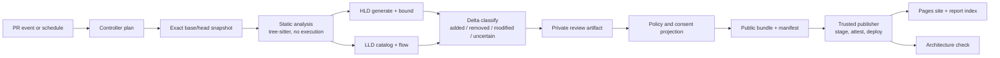

# CodeShouldBehave — application digest

What this system does, how it does it, and what is actually running.

Snapshot: **2026-11-16** · `main` `8ac2e652cc26f857badfb563a11317d3ddc72e39`

> This is an engineering digest, not a product promise. Where the README or older
> status notes lag the live system, this snapshot takes precedence and says so.

## 1. In one paragraph

CodeShouldBehave reviews a Rust pull request as a pinned comparison between two
commits. It shows the observed architecture change (HLD), the supported local
behavior (LLD), and the exact baseline/proposal source behind each claim. It is
deliberately bounded: unsupported files, deferred inventory and unresolved
differences stay explicit. It does not execute reviewed code, does not approve a
merge, and does not prove runtime behavior.

## 2. Current snapshot

| Item | Value |
|---|---|
| Repository | SSC-SDE/CodeShouldBehave (public, MIT) |
| `main` | `8ac2e65…` — docs: landing publication record |
| Pinned engine commit | `6b5fce6…` — the landing redesign commit |
| Engine release | `canary-6b5fce6073fe` (prerelease, attested) |
| HLD profile | `csb-hld-rust-static-v7` |
| LLD profile | `csb-lld-rust-static-v1` |
| LLD IR | `tree-sitter-rust-0.24.2-core-0.25.10-lld-ir-v1` |
| Review artifact | `csb-review-artifact-v1` |
| Public bundle | `csb-public-report-v1` |
| Live site | https://ssc-sde.github.io/CodeShouldBehave/ |
| Live reports | **5** — PRs 53, 63, 48, 80, 24 |
| Live landing | `index.html` `c476b28f…`, `assets/landing.css` `a4749237…` |
| Site bytes | 40,080,029 B of 64 MiB |
| Rust tests | 267 lib passed |
| Integration tests | 18 public-report passed |
| Python tests | 269 passed, 6 skipped |

Two facts explain most of the current shape:

1. The publisher builds the public site from the **pinned engine package**, not
   from `main`. A landing or site change ships only after a new attested engine
   release is pinned.
2. The site keeps a bounded archive. Reports retire explicitly or on merge under
   the retention policy; the live count is not the historical count. This digest
   and README now record the 2026-11-16 live index and pinned release.

## 3. The problem it addresses

A pull request diff answers “which lines moved?” It does not answer:

- which components, contracts and dependencies changed;
- which local behavior is supported by the changed code;
- where the exact baseline and proposal source is;
- what the analysis could not see.

CodeShouldBehave answers those as one connected review, with evidence pinned to
commits. The trade is explicit: bounded static analysis, not a runtime proof.

## 4. What a reviewer sees

1. **GitHub check.** A PR revision gets `CodeShouldBehave / Architecture`.
2. **Report entry.** The check links to a published report; direct dashboard
   entry opens **Standard**, while the check link opens **Focus** with the
   pinned comparison.
3. **Focus.** A changed-boundary list beside a compact map and the selected
   element's commit-bound source evidence.
4. **HLD.** Observed components, contracts, dependencies, schemas, deployment
   configuration, relations and coverage. Choose a component to drill down.
5. **LLD.** A Rust catalog of declarations and functions, local control flow,
   and on-demand detail for a selected entry.
6. **Source.** Exact commit, path, blob and line span for baseline or proposal.
   Split/unified and before/after controls.
7. **Evidence and scope.** Coverage gaps, deferred detail and explicit
   uncertainty. A newer head does not rewrite an existing report.

Workspace appearance is independent of analysis: Standard or Focus layout,
Graphite/Blueprint/Terminal/Contrast themes, HLD Studio or Classic presentation,
panel ordering, filters, and two decorative backdrops (Etched Ring in Standard,
Moria colored-text in Focus HLD). Backdrops are not evidence. Reduced motion and
forced colors are respected.

## 5. How the pipeline works



### 5.1 Planning

`.github/workflows/csb-public-nudge.yml` wakes the controller on PR
`opened`, `reopened`, `synchronize`, `ready_for_review`, `converted_to_draft`
and `closed`. `.github/workflows/csb-public-controller.yml` also runs on a
10-minute schedule and on manual dispatch. Planning discovers public PRs,
observes current commits, applies reservations and the application REST budget,
and emits exact requests.

### 5.2 Snapshot and analysis

The engine reads exact Git objects for the selected baseline and proposal. It
does not contact the network and does not run reviewed code. `flowdiff` parses
Rust with tree-sitter, builds file-level architecture nodes and edges, then the
HLD and LLD layers. Unsupported files and deferred regions are recorded rather
than guessed.

### 5.3 HLD

The HLD profile covers Rust public declarations, explicit package dependencies,
schema artifacts and static deployment configuration. It produces components,
contracts, dependencies, schemas and deployments; relations; evidence; and
coverage. Each version is bounded to **900 KiB**. Trimming is path-aware:
changed paths and their facts are retained first, then the remaining inventory
by class. Removed facts are recorded in a compact **deferred-fact index** so a
later comparison can distinguish “trimmed” from “absent”.

### 5.4 LLD

The LLD catalog consumes the retained syntax inputs and produces declaration,
function, flow and detail records. Detail is generated on demand within a
bounded budget. The LLD is not a second analysis opinion; it is the same
pinned comparison at a lower level.

### 5.5 Delta

The comparison reports `added`, `removed`, `modified`, `moved`, `split`,
`merged`, and `uncertain`. One-sided facts are resolved from the deferred-fact
index by semantic fingerprint:

- fingerprint matches → unchanged;
- fingerprint differs → modified;
- absent from inventory and evidence scope → `uncertain`.

On the v7 demo comparison (`a849afb` → `3bc3def`), `uncertain` fell from 201
(101 elements + 100 relations) to **1** (a root component boundary), while
`added` stayed at 145 (72 elements + 73 relations).

### 5.6 Export and publication

The private review artifact is not uploaded. A public policy and explicit
consent project it into a source-bounded public bundle. The trusted controller
downloads the attested engine, analyzes in a networkless `bubblewrap` sandbox,
verifies evidence and hashes, stages a site snapshot, reserves Pages and
artifact capacity, deploys, reads back, and commits a signed state receipt.
Checks are delivered only after that state is durable.

## 6. Analysis model and data

### 6.1 HLD records

| Record | Meaning |
|---|---|
| `DesignVersion` | One pinned snapshot: repository, commit, scope, elements, relations, evidence, sections, coverage |
| Element | `component`, `contract`, `dependency`, `schema` or `deployment` |
| Relation | Directed connection with kind, protocol, synchrony, resolution and evidence |
| Evidence | Repository, commit, path, blob, line span and producer version |
| Coverage | Complete flag, indexed/unsupported/failed counts, gaps, deferred kinds, deferred paths, deferred facts |
| `DesignDelta` | Changes, possible impacts, questions, findings, coverage, Mermaid |

Each version is bounded: 2,000 paths, 2,000 facts, 2,000 deferred paths, a
10 MiB read budget, a 10-second analysis budget and the 900 KiB serialized
envelope. Components are never trimmed. Contract inventory is trimmed first
outside changed paths, then schema, dependency and deployment.

### 6.2 LLD records

The LLD catalog contains entries, a per-snapshot graph and a delta. A detail
record contains the entry, graph, evidence, flow and rendered Mermaid/Markdown.
The initial detail budget is 100 entries. LLD source and details are
commit-bound; an unavailable excerpt is reported, never substituted.

### 6.3 Review artifact

`csb-review-artifact-v1` is the private machine artifact. It contains the
comparison identity, files, architecture nodes/edges, warnings, coverage, HLD
status, LLD status, onboarding context, and optional HLD/LLD payloads. Rendered
Markdown and Mermaid are omitted from artifact HLD copies and regenerated by
consumers, removing duplicate payload.

### 6.4 Current v7 measurements

| Measure | Value |
|---|---:|
| Demo artifact | 2,982,294 B |
| HLD baseline / proposal | 678,209 / 645,895 B |
| Deferred facts | 1,400 (700 elements + 700 relations) |
| Deferred-fact bytes | 107,102 B |
| Retained inventory | 212 contracts / 226 elements |
| Added | 145 (72 elements + 73 relations) |
| Uncertain | 1 |

## 7. Public report and site

### 7.1 Bundle

`csb-public-report-v1` is validated as a manifest plus inert JSON/Markdown
files. The manifest pins repository, PR, baseline, proposal, policy digest,
engine, coverage, capabilities and routes. Its identity is a canonical hash; a
bundle cannot rename itself or add unreferenced files. Limits: 8 MiB public
bytes, 1,000 files, 4 MiB manifest.

Typical report routes:

- `manifest.json`
- `artifact.json` — public projection
- `hld.json` — baseline, proposal, delta, export views
- `lld/catalog.json` and `lld/detail/...`
- `sources/...` — authorized excerpts
- `exports/review.md`

### 7.2 Immutability and archive

Each report is an immutable identity for one comparison. A newer head creates a
new report; it does not edit the existing one. The site index is the last
observed/published state, not a live-current promise.

Retention is bounded:

- 64 MiB expanded-byte site cap;
- 20,000 files and 4 MiB manifest cap;
- 100 retained reports;
- 172 MiB repository artifact reservation;
- published generations preserve the last permitted site on failure.

Reports retire explicitly through `.codeshouldbehave/report-retirements.json`
or automatically when the PR is provider-confirmed merged, under
`.codeshouldbehave/report-retention.json` (`retire_on_merge`, configurable
0–90 day grace). Removed reports get a source-free expiry record. Downloaded
public content cannot be recalled.

### 7.3 Landing page

The landing page is static HTML/CSS, no JavaScript, with a `script-src 'none'`
CSP. It uses bundled Inter and JetBrains Mono fonts, three genuine captures of
published reviews, system light/dark themes, reduced-motion and forced-colors
handling. It is assembled from the **engine package**, so changing it requires a
new attested release. Current live hashes match `main`.

## 8. Onboarding

### 8.1 GitHub Actions + Pages (working on this repository)

This is the only currently working installation profile for a new public
repository. Setup is maintainer-led, not a one-click install:

1. Base-owned public path policy and confirmed component context.
2. Immutable analyzer package and workflow pins.
3. Pages configuration.
4. Hard-zero Actions and Packages budgets, with an operator observation.
5. Explicit activation evidence; a PR cannot widen its own policy.
6. Reviewed installation diff, then enable.

Templates live in `templates/public-ci/`; copying them is not activation.
Reviewers need no terminal, API key or local server. Private/related
repositories and external services are outside the initial public context.

### 8.2 Local CLI (working)

```sh
rustup toolchain install 1.87.0 --profile minimal
cargo +1.87.0 build --locked --all-features --bins
target/debug/flowdiff review \
  --base <baseline> --head <proposal> --repo <path> \
  --onboarding-context accepted-context.json \
  --artifact review.json --format html --output review.html
```

`flowdiff` never contacts the network or runs reviewed code. `--disable-hld` or
`--disable-lld` create distinct review identities; they do not relabel a
structural sketch as the missing level.

### 8.3 GitHub App (in development; not installable)

Implemented and tested locally: OAuth/PKCE, repository picker, versioned scope
confirmation, isolated source preview, inactive architecture acceptance,
webhook intake, PR worker, host dispatcher, signed report server, check
delivery, queued/running/failure check states, signed operator approval and
offline recovery tools. Twenty-five SQLite migrations cover setup, scope drafts,
previews, webhook inbox, execution, publications, consent safeguards, discovery,
activation, recovery and check progress.

Not active: qualified USD-0 Linux hosting, freshly signed sandbox workers,
independent host/engine authorities, externally fresh backup/fencing authority,
and live fresh-repository acceptance. Dispatch defaults paused; browser consent
never activates it. Installing the registered App does not enable checks.

## 9. Trust and security model

- **No reviewed code execution.** Rust is parsed with tree-sitter; the analyzer
  reads Git objects and source text. It does not build, run or import the
  reviewed repository.
- **Networkless analysis.** The controller runs analysis in an isolated,
  networkless `bubblewrap` sandbox with exact Git objects.
- **Private artifact, public projection.** Raw review artifacts stay private.
  A base-owned policy and explicit consent decide what may become public. The
  exporter pins hashes and never uploads the private artifact.
- **Attested engine.** The Linux engine is built by the trusted default-branch
  workflow, signed with a Sigstore attestation, and pinned by commit, package,
  binary and attestation digests. Bootstrap verifies the bundle before use.
- **Pinned trust inputs.** Workflow, policy and context hashes are pinned in
  `public-ci.json`. A PR cannot rewrite its own policy; analysis requires the
  exact current default-branch controller.
- **Budget hard stops.** Actions and Packages must be at enforced USD 0 with
  “prevent further usage”; the operator observation is an explicit attestation,
  not a live billing API claim. The pipeline never buys credits or upgrades.
- **Bounded publication.** The site, manifest, file count, retained reports and
  artifact reservation all have caps. Capacity failure preserves the last
  permitted generation rather than evicting silently.
- **Advisory checks.** A completed Architecture check is not a merge approval.
  Unsupported or deferred analysis is explicit, and a missing excerpt is never
  replaced with another revision.
- **Landing surface.** Static HTML/CSS, no JavaScript, no analytics, no forms,
  no login, `script-src 'none'`, bundled fonts, same-origin images.

The application’s security posture is therefore “fail closed and show the
boundary”, not “guess and look complete”.

## 10. Storage and data

The Rust service uses bundled SQLite (`rusqlite`), WAL-style bounded artifacts,
and immutable review/design records. Twenty-five migrations cover:

| Range | Concern |
|---|---|
| 0001–0004 | Foundation, indexes, graph navigation, incremental change sets |
| 0005–0009 | Scheduler, provider intake, export jobs, AI audit, review continuity |
| 0010–0014 | Onboarding, onboarding defaults, design, LLD defaults, workspace preferences |
| 0015–0025 | App setup, scope drafts, architecture preview, webhook inbox, execution, publications, consent safeguards, discovery, activation, recovery, check progress |

Additional bounds: 64 MiB database-copy, 1 MiB stored design payload, 200 design
corrections, 100 AI evidence items / 256 KiB, 150 reviewed files / 512 KiB per
blob. Artifacts are content-addressed and reference-safe; backups restore only
referenced artifacts and detect corruption.

## 11. Binaries and commands

| Binary | Role |
|---|---|
| `flowdiff` | Local review, index and demo; produces HTML/Markdown and the private artifact |
| `csb-onboarding` | Trusted local operator bridge for onboarding, HLD/LLD, preview/accept and export |
| `csb-public-report` | Public bundle exporter/verifier; consumes the private artifact and policy |
| `csb-app-preview` | Local App preview of scoped architecture and source |
| `csb-app-host` | App host/listener with provider and webhook adapters |
| `csb-app-pr-worker` | Bounded PR worker for App execution |
| `csb-app-operator` | Signed operator actions and activation |
| `csb-app-recovery` | Exact offline recovery tools |

Operational scripts:

- `scripts/public_ci.py` — planning, analysis request, publication state machine,
  budget verification, publisher server/client.
- `scripts/public_site.py` — site assembly, manifest, verification.
- `scripts/build_public_release.py` — source/runtime archives, native build,
  license/SBOM and package manifest.
- `.codeshouldbehave/bootstrap.py` — download, hash and attest the pinned engine.

## 12. Limits and explicit non-claims

| Limit | Value |
|---|---:|
| HLD serialized version | 900 KiB |
| HLD paths / facts / deferred paths | 2,000 / 2,000 / 2,000 |
| HLD read / time budget | 10 MiB / 10 s |
| LLD initial details | 100 entries |
| Private review artifact | 16 MiB |
| Public bundle | 8 MiB / 1,000 files |
| Site | 64 MiB / 20,000 files / 4 MiB manifest |
| Retained reports | 100 |
| Repository artifact reservation | 172 MiB |
| Reviewed files per patch | 150 |
| AI evidence | 100 items / 256 KiB |

Explicit non-claims:

- runtime behavior, call effects, delivery or ownership guarantees;
- merge approval or product correctness;
- complete coverage of unsupported languages, macros, conditional compilation,
  workspace/Git dependencies or unavailable source;
- a general hosted service, capacity promise or App availability;
- a live-current index; the index is last observed/published;
- billing capacity visible through a repository token.

## 13. Verification and current health

| Check | Result |
|---|---|
| `cargo test --lib --features server` | 267 passed |
| `cargo test --features server --test public_report` | 18 passed |
| `python3 -m unittest discover -s tests -p "*test.py"` | 269 passed, 6 skipped |
| Public site build/verify tests | 20 passed, 6 skipped |
| Landing responsive check | 1440 / 1024 / 768 / 390 / 320 px, light and dark, no overflow |
| Live landing hashes | match `main` |
| Live index | 5 reports; no stale v4 report |
| Engine attestation | `gh attestation verify` status 0 |

The live site is currently 40,080,029 B of 64 MiB. Five reports remain: PRs 53,
63, 48, 80 and 24. The PR 63 report is the v7 report with 145 added and 1
uncertain (the root component boundary).

## 14. Repository map

| Path | Contents |
|---|---|
| `src/design.rs`, `src/design/` | HLD types, generation, trimming, certainty, diff, render, wire |
| `src/lld.rs`, `src/lld/` | LLD catalog, flow, detail, diff, render |
| `src/analysis.rs`, `src/snapshot.rs`, `src/git.rs` | Exact Git comparison, bounded blobs, static analysis |
| `src/review_artifact.rs` | Versioned private review artifact |
| `src/public_report/` | Public policy, projection, validation, bundle writer |
| `src/design_storage.rs`, `src/storage.rs` | SQLite design/review/artifact persistence |
| `src/github_app_setup/` | App OAuth, scope, preview, webhook, worker, host, reports, activation |
| `src/workspace*.js/css/html` | Focus/Standard dashboards and preferences |
| `src/landing.*`, `src/landing/` | Public landing source and genuine captures |
| `src/bin/` | CLI/service binaries |
| `scripts/` | Public CI, site builder, release builder |
| `templates/public-ci/` | Installation templates and maintainer guide |
| `migrations/` | 25 SQLite migrations |
| `.codeshouldbehave/` | Policy, context, engine pins, budget evidence, retention |
| `.github/workflows/` | Engine build, controller, nudge, canary preflight |
| `docs/` | Status, usage, decisions, App plan and this digest |

## 15. Known gaps and next work

1. **App activation (external).** Backend hosting, signed workers, independent
   authorities, external recovery freshness and live fresh-repository acceptance
   still require owner-provided infrastructure and credentials.
2. **Uncertainty labels (closed).** W3.3 shipped in
   [PR #81](https://github.com/SSC-SDE/CodeShouldBehave/pull/81), merged
   `864ec896e7e540ef31310250b5acb0d0a1690efc`. Focus/Standard HLD render the
   trimmed-inventory notice with deferred-path links.
3. **Pre-flight publication admission (closed).** W2.2 shipped in PR #81: the
   planner reads the signed retained site manifest and reserves 9 MiB per
   admitted report before analysis.
4. **Dedupe (deferred).** ID interning, baseline+delta encoding and compressed-
   byte site accounting remain measured candidates. W2.2 now prevents analysis
   from outrunning publication capacity, so none is required for the current
   profile.
5. **Documentation freshness (closed).** README, this digest and the decisions
   record were refreshed on 2026-11-16. Historical release evidence remains
   historical by design.
6. **One residual uncertainty.** The v7 demo’s single uncertain item is the root
   component boundary, not a contract or relation. It is reported, not hidden.
7. **AI extension (deferred).** The optional explanation feature remains outside
   the public first-release profile; no provider is connected.

## 16. Glossary

- **HLD** — high-level design: components, contracts, dependencies, schemas,
  deployment configuration, relations and coverage.
- **LLD** — low-level design: declarations, functions, local flow and detail.
- **Evidence** — exact repository, commit, path, blob and line span.
- **Coverage** — what was indexed, unsupported, failed, deferred or unresolved.
- **Deferred fact** — an observed element/relation removed by bounded trimming,
  retained as a short identity + semantic fingerprint.
- **Review artifact** — private versioned machine output of one comparison.
- **Public bundle** — validated, source-bounded projection of that artifact.
- **Engine** — attested Linux package containing the analyzer and publication
  helpers.
- **Controller** — trusted default-branch workflow that plans, analyzes,
  publishes and commits state.
- **Nudge** — minimal PR-event workflow that wakes the controller.
- **Retention** — bounded removal of published reports, explicit or on merge.
- **Advisory check** — a review signal, not a merge approval.


