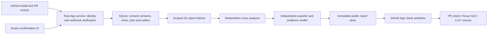

# GitHub App onboarding implementation plan

Status: **approved; Phase 6 implementation in progress; activation off**.
Updated November 6, 2026 (IST). APP-0 hosting research and the APP-1 local
identity boundary are implemented as described in [implementation notes](APP_ONBOARDING_DEVELOPMENT.md).
No hosted onboarding acceptance, App permission change or deployment is implied.
The existing Actions/Pages installation and open demo PR #24 remain intact.

## Outcome and current evidence

Target: **Install CodeShouldBehave → choose repositories in GitHub → confirm
scope in the browser → automatic Architecture checks → Focus report**.
Customers do not create workflow files, copy JSON, configure Pages, enter keys,
run a terminal or merge an installation PR in this target profile.

Today the public repository uses its own Actions controller and Pages project
site. PR #30 merged at `c877af8ae2d25c2cf2773c70a0c6fa8499ba3d84` and records
successful [live controller 42083656278](https://github.com/SSC-SDE/CodeShouldBehave/actions/runs/42083656278)
and [PR #24 check](https://github.com/SSC-SDE/CodeShouldBehave/runs/127446113035).
Those prove the own-repository demo, not a hosted multi-installation App service.
The registered App/local login and the existing deterministic engine are useful
building blocks; installation alone currently does not provision automatic checks.

## Product decisions

- First App release: public repositories, Rust HLD/LLD, independently confirmed
  scope per repository. Several repositories may be installed, but their source
  contexts never combine implicitly. Private repositories, AI, external service
  access and cross-repository analysis are deferred.
- Preserve the current Focus header/themes, HLD and LLD views and source behavior.
  PR entry specifies Focus; direct dashboard entry specifies Standard. Existing
  immutable report URLs remain usable subject to withdrawal/retention policy.
- Keep Actions/Pages as an advanced self-managed option. The App profile runs
  the analyzer on operator-managed infrastructure and owns its check results.
  Do not generate repository workflows as a hidden implementation of one-click
  installation: that would require content/workflow writes and another merge.
- Reuse Rust, SQLite, the signed Linux engine and the public exporter. No new
  database platform, Kubernetes, AI subscription or paid fallback is required.
- A continuously reachable backend and isolated Linux execution are required.
  Static GitHub Pages cannot receive authenticated webhooks or hold App keys.
  No suitable hosted USD 0 service has been qualified. Initial deployment must
  use operator-provided infrastructure with verified zero incremental charge,
  or a separately approved hosting decision. Local implementation continues while host qualification remains open;
  do not advertise unlimited free hosted analysis or use a laptop tunnel as
  production availability evidence. The existing USD 0 CI path stays available.

## Reviewer and maintainer journey

1. **Install.** The landing page sends the maintainer to GitHub's App installation
   screen with selected-repository access. GitHub organization approval remains
   GitHub's responsibility; pending approval is shown, never bypassed.
2. **Resume setup.** Return to an authenticated setup session. Show only installed
   repositories the current user can administer. Preselect the repository if it
   is unambiguous; do not ask users to paste an owner, repository ID or PR URL.
3. **Scope.** Show a path tree, detected language eligibility, public-report
   destination and exclusions. Metadata listing may show paths; source reading
   starts only when the user chooses **Preview selected paths**. That action
   grants a temporary scan of the displayed paths at the displayed commit.
   Excluded paths, submodules and related repositories stay outside the scan.
4. **Confirm.** On the same screen, show component boundaries and coverage gaps.
   Permit component/name/root corrections supported by evidence. The final
   **Confirm scope & enable checks** action accepts the exact scope, architecture,
   known gaps and publication of authorized excerpts. No raw JSON is required.
   If the default commit or draft scope changed, refresh the preview and reconfirm.
5. **Ready.** Display enabled status and the first analysis progress. By default,
   queue eligible existing open non-draft PRs within capacity, as disclosed on
   confirmation. Draft analysis is an explicit per-repository setting, off by
   default. Future opened/reopened/synchronize/ready-for-review events need no
   additional maintainer action. Closed PRs cancel pending work.
6. **Review.** The Architecture check links directly to the exact Focus report.
   HLD, LLD and source navigation work as in the live demo. Repository/dashboard
   links lead to Standard. Users can pause, narrow scope or uninstall from Settings.

No existing repository is automatically migrated or enrolled by this plan.

## Service boundaries

- Extend the optional Rust service rather than the offline CLI. The credential
  broker owns App authentication and GitHub calls. Workers receive bounded,
  read-only objects and an immutable scope document, not tokens or private keys.
- SQLite stores installations, numeric users/repository IDs, versioned scope and
  architecture consent, webhook inbox, leased jobs, report metadata and delivery
  outbox. Use additive transactional migrations; preserve existing review and
  preference records. Every record and lookup includes installation/repository
  ownership; URL IDs alone never authorize a read or write.
- Serve public reports from a separate cookie-free report origin on the same
  approved infrastructure. Keep login, settings and secrets on the service origin.
  Reuse bundled assets/CSP and the static report transport. The first deployment
  requires bounded filesystem storage, an atomic report catalog and tested backup
  and restore; a managed database/object store is not assumed. Proposed default:
  public reports expire after seven days, raw fetched objects after the job finishes,
  and diagnostic/event records after 30 days. Keep active consent and the minimum
  receipt/withdrawal ledger needed to prevent unsafe restoration. Bound storage
  per installation and globally in APP-0. Show retention before confirmation;
  expired links show an explicit unavailable page and a reanalysis option.
- Accept only the independently verified signed engine release. Reuse schema,
  archive, scope, counterpart and source-digest validators. App publication needs
  a new versioned receipt adapter binding tenant, repository, consent revision,
  commit pair, engine, manifest and public URL. Sign it using the service's
  protected signing key and retain a verifiable append-only chain plus backups.
  This is a distinct trust profile: never manufacture GitHub-hosted OIDC evidence
  or silently reuse the current repository-specific Pages receipt ledger.
- Verify complete staged bytes, commit publication intent, atomically expose the
  immutable report, read back the public manifest and required assets, and commit
  promotion before the durable outbox posts a completed check. On interruption,
  recover only the exact intent. Do not return a green result or empty dashboard.

## Authentication, permissions and events

Use the existing App registration where feasible; do not change its permissions
until the operator approves the concrete deployment. Proposed repository access:

| Permission | Level | Purpose |
| --- | --- | --- |
| Metadata | Read | Numeric repository and installation identity |
| Contents | Read | Pinned Git objects within confirmed scope |
| Pull requests | Read | Exact current base/head, state and PR events |
| Checks | Write | App-owned queued/running/completed checks |

No repository Administration, Contents write, Workflows write, Issues write or
customer Actions/Pages permission is needed for this architecture. App repository
access is broader than file-level scope; enforce path restrictions in our service
and worker independently. Existing installations must explicitly approve any
new GitHub permissions before activation.

- Configure HTTPS webhook and post-install setup URLs. Use setup redirect followed
  by web authorization when necessary; keep setup and OAuth callback distinct.
  Validate OAuth state, session expiry and server-side installation membership.
  An `installation_id` query parameter is not proof of ownership. Require current
  repository administration authority for scope confirmation, not merely login.
- Keep the App private key, webhook secret and short-lived installation/user tokens
  server-side in the host secret store. Limit installation tokens to the selected
  repository and required permissions; refresh on expiry. Secure HttpOnly session
  cookies, CSRF protection and account-switch clearing apply. No credentials in
  browser storage, reports, Git files, logs or analyzer environments.
- Subscribe to installation, installation_repositories, pull_request and check_run
  events. Verify raw-body HMAC-SHA256 before parsing/processing, bound payload
  size, and persist a unique delivery ID before acknowledging. Handle duplicates,
  delayed/out-of-order delivery and process restarts idempotently. Re-fetch current
  provider state before enqueue/publication; a webhook is a notification, not an
  authority grant. Only our own check_run rerequested events may enqueue reruns.
- Suspension, repository removal, deletion, conversion to private or uninstall
  immediately disables new work and revokes queued leases. Publication rechecks
  access and public visibility. Block report retrieval and queue withdrawal on
  the controlled report origin. Previously downloaded public copies cannot be
  recalled. Reinstallation gets a new consent generation, not old implicit access.

GitHub documentation: [setup URL and ownership](https://docs.github.com/en/apps/creating-github-apps/registering-a-github-app/about-the-setup-url),
[installation versus authorization](https://docs.github.com/en/apps/using-github-apps/installing-a-github-app-from-a-third-party),
[permission changes](https://docs.github.com/en/apps/maintaining-github-apps/modifying-a-github-app-registration),
[webhook verification](https://docs.github.com/en/webhooks/using-webhooks/validating-webhook-deliveries).

## State, scheduling and exact comparisons

Repository state: `installed_unconfigured → scope_preview → awaiting_confirmation
→ indexing → enabled`; explicit alternatives are `awaiting_org_approval`,
`paused`, `permission_required`, `quota_paused`, `error` and `revoked`.
Installation must not start whole-repository source scanning or check publication.
Confirmation atomically records scope/architecture version and activates indexing.
Initial indexing uses only the authorized scope, not every file GitHub can read.
Cache keys include commit, scope and engine; subsequent PRs update this baseline.
Structural drift requiring a new boundary cannot silently enlarge accepted context.

- Job key: installation ID, repository ID, PR number, selected baseline, resolved
  merge-base, head SHA, consent version, engine digest and analysis version.
  A new head/base/consent generation supersedes old pending work. Old reports keep
  their exact identities; they cannot be presented as the new PR result.
- Default baseline: selected PR base's merge-base with head. Base retargeting and
  movement are reconciled as new comparisons. Support pinned stable baseline as
  an advanced setting; keep both selected and resolved baseline in the report.
- Bounded launch defaults: two workers globally, one active job per repository,
  100 pending jobs globally, finite per-installation fairness and a 15-minute job
  ceiling. Inherit current engine/file/site caps; do not lower protections to fit
  more jobs. These are proposed limits, not measured capacity claims.
- Reserve at most 100 application REST calls per analysis/publication attempt,
  including retries; meter scans/reconciliation separately within explicit host
  limits. Stop admission when CPU, memory, disk, API or verified cost allowance
  is exhausted. Retain a visible `quota_paused` result and retry only when eligible.
  Do not auto-purchase capacity or assume account-wide free allowance remains.
- Persist leases, heartbeats and a check-delivery outbox. Retry transient failures
  with capped backoff (two retries); on hard failure expose Retry and a reason.
  A bounded ten-minute reconciliation sweep repairs missed events and pending
  check delivery. This is a target interval, not a guaranteed completion latency.
- Fork objects are data only: no checkout, hooks, submodules, builds, dependency
  installs or PR scripts. Deny private/inaccessible fork sources. Public fork
  support must pass its own end-to-end gate, including exact-head check binding;
  do not infer PR ownership from GitHub's check-run pull_requests array.

## Check and dashboard contract

Name: `CodeShouldBehave / Architecture`, owned by the registered App. Use a stable
external ID derived from the job identity; update only that App's matching check.
Set `details_url` and retain **Open CodeShouldBehave report** in the summary.
Links pin repository, exact report/bundle and revisions, with `mode=focus` and
`design=hld`; direct dashboard navigation opens Standard. URLs contain no tokens.
Current Actions-owned links remain valid and may enter LLD first.

| Actual result | GitHub conclusion | User-facing title |
| --- | --- | --- |
| Queued / running | queued / in_progress status | Queued / Analyzing selected scope |
| Complete supported comparison, no detected change | success | No supported behavior change detected |
| Detected change with verified report | neutral | Ready · Changes to review |
| Partial/unsupported evidence with verified report | neutral | Ready · Coverage incomplete |
| Scope/permission needs owner action | action_required | Setup or permission required |
| Analyzer/publication failure without verified report | failure or timed_out | Analysis unavailable |
| Superseded/closed/cancelled work | cancelled | Superseded or cancelled |

“No supported behavior change detected” never means runtime equivalence. Keep
behavior result and coverage separate in payloads. GitHub controls check glyphs
and colors; an exact orange check is not an API guarantee. Use clear text and
an amber review badge in the dashboard; do not misuse failure or action_required
just to obtain a color. Checks remain advisory, not merge approval.
[GitHub check API](https://docs.github.com/en/rest/checks/runs).

## Ordered implementation checkpoints

Implementation runs on `phase-6`, based on provider-confirmed merged PR #30
(`c877af8ae2d25c2cf2773c70a0c6fa8499ba3d84`). APP-0 research is recorded in
[hosting options](APP_HOSTING_OPTIONS.md); no account/host is available or qualified.
APP-1 has locally tested OAuth/PKCE, current-user installation/admin validation,
repository selection and additive persistence. The browser picker and inactive
APP-2 path-intent preview/confirmation are implemented and tested with fixtures.
An additional local slice implements explicit scoped source preview, component/gap
review and inactive architecture acceptance, plus authenticated durable webhook
intake. Installation-token issuance, current-PR queueing and signed report/check
outbox primitives now have local tests, including real exported HLD/LLD/source
fixtures. Publication consent, the PR worker/host dispatch loop, actual public
report delivery and live OAuth remain pending. APP-2 through APP-6 have not passed their full exit gates. No activation or phase acceptance is
claimed; see the [progress tracker](implementation-progress.md).

| Checkpoint | Deliverable | Exit evidence |
| --- | --- | --- |
| APP-0: host and contract | Approved Linux host, HTTPS origins, secret management, operator budget/retention limits and recovery design | Recorded USD 0 feasibility, signed engine starts in unchanged sandbox, persistence survives restart; no paid fallback |
| APP-1: install identity | Setup/OAuth routes, tenant tables and permission checks | Spoofed installation, wrong user, missing admin, suspended installation and denied org approval fail closed; keys never reach UI |
| APP-2: scope onboarding | Path selection, explicit preview scan, component/gap review and atomic confirm/enable | Two installations isolated; stale previews rejected; excluded source never read; confirmation actor/commit/fingerprints auditable |
| APP-3: automatic jobs | Durable webhook inbox, fair queue, scoped fetcher and isolated worker adapter | Duplicate/out-of-order/fork/base-retarget/new-head/restart tests; bounded retries/resources and no execution of PR code |
| APP-4: reports and checks | App receipt adapter, immutable verified publication, outbox and exact Focus link | Interrupted publication recovers exact intent; incorrect tenant/head cannot get a link; check titles/conclusions match evidence |
| APP-5: real onboarding acceptance | Fresh second public repo installed through browser alone | Maintainer installs/selects/confirms with no terminal/workflow/Pages/config PR; two PR revisions and a fork tested; actual check opens HLD/LLD/source |
| APP-6: operations and opt-in rollout | Pause/revoke/withdraw/reinstall, bounded retention, backups and cost visibility | Removal/privacy change blocks access, safe restore respects withdrawal, quota test pauses visibly, no cross-tenant leak; owner explicitly approves launch |

APP-1 interface design/local tests may begin after plan approval while host
qualification proceeds; external activation waits for APP-0 and all predecessors.
Do not mark the target delivered at APP-2 merely because the wizard looks complete.
100+ PR/day capacity and broader language/private-repository support require their
own measurements and remain outside initial acceptance.

## Acceptance checklist and migration

- [ ] Install on a second public repository with a fresh maintainer session.
- [ ] Confirm repository administration and exact consent without copying config.
- [ ] New/updated PR automatically gets a correctly owned exact-head check.
- [ ] Actual Details/summary link opens Focus, HLD split/unified, LLD and exact source.
- [ ] Report missing, incomplete, stale, quota-paused and unsupported cases honestly.
- [ ] Exercise forged/replayed deliveries, token expiry, restart, fork and scope narrowing.
- [ ] Verify uninstall/private conversion withdrawal and tenant isolation.
- [ ] Confirm keyboard/narrow-screen onboarding and unchanged HLD/LLD viewer behavior.
- [ ] Run existing engine, public-report, workspace, authorization and recovery suites.
- [ ] Operator approves cost evidence, permission change and live activation separately.

Existing CI installs opt in explicitly. Never run both check publishers for the
same repository as the normal state. Test the App in a separate canary repository,
then pause the old controller, preserve its signed history/reports, verify no live
lease remains and enable App ownership. Record a migration receipt. Rollback
pauses App admission/publication before re-enabling the old controller; it never
rewinds old consent or restores withdrawn bytes. PR #24 is not a migration target.

Only the operator configures App keys, webhook/callback/setup URLs, HTTPS and
capacity once. End users install/select/preview/confirm; organization permissions
or rejected billing eligibility get a clear blocking state, not manual YAML steps.
The optional installation-token/current-PR broker, durable queue and signed-intent/
completed-check outbox primitives now have local tests; see the
[execution checkpoint](APP_EXECUTION_DEVELOPMENT.md). The scoped PR object fetcher,
credential-free analysis adapter, paused host dispatcher and separate signed report
server/readback are now connected locally. Browser final consent, fair dispatch,
durable REST reservations, tracked-PR repair, App-owned rerequests and bounded
expiry/withdrawal recovery have local tests. Operator activation, host/Linux sandbox
qualification, initial PR discovery, status UX, trusted backup restoration and live
acceptance remain pending. The source-preview
and inactive architecture review are implemented; see [current checkpoint](APP_SOURCE_PREVIEW.md).
Live OAuth/worker qualification and activation remain separate and require an
approved host and operator configuration.
